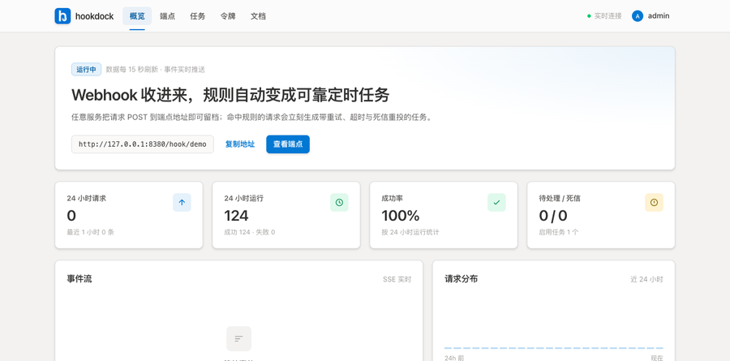
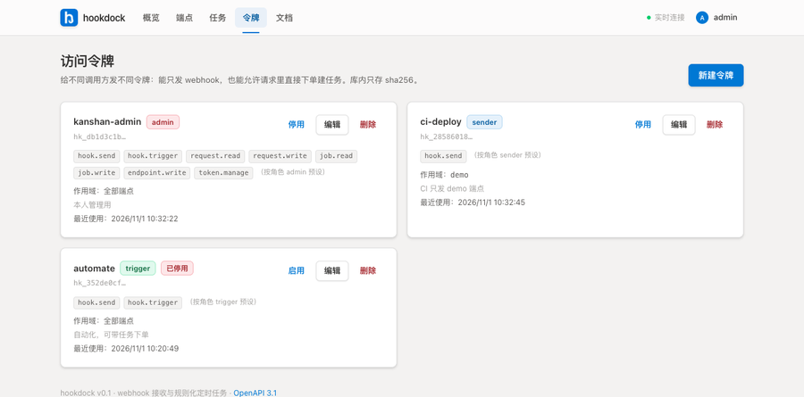
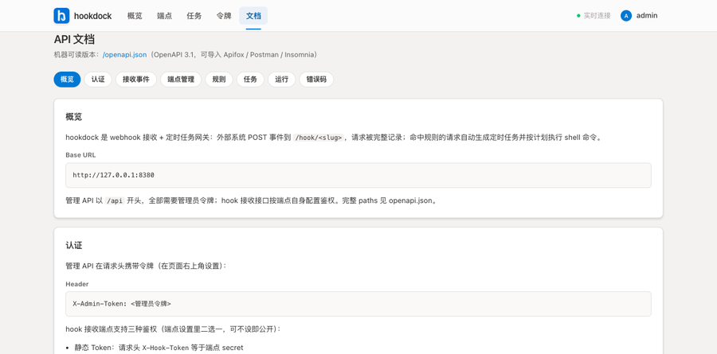

<div align="center">


# hookdock

**Webhook 收进来，规则自动变成可靠定时任务。**

[](https://hub.docker.com/r/littlepawn/hookdock)
[](https://github.com/littlepawn/hookdock)


</div>

---

Webhook 接收 + 规则化定时任务网关。单二进制（Go + SQLite，无 CGO），前端 React 19 + Vite + Tailwind v4 内嵌为 embed，一条命令起容器。

| 概览 | 访问令牌 | API 文档 |
|---|---|---|
|  |  |  |

## 为什么是 hookdock

- **收**：任意服务把请求 `POST` 到 `/hook/<端点>` 即留档，可回看、可重放。
- **判**：规则按 body / query / header 字段匹配，命中即下单。
- **跑**：任务带重试、超时杀进程树、死信重投、重启补跑——可靠执行，不只是 fire-and-forget。
- **管**：多令牌 + 细粒度权限 + 端点作用域，给 CI、自动化、人各发各的钥匙。

## 特性

- **端点**：每个端点一个对外 URL（`/hook/<slug>`），支持 `none` / `token` / `hmac`（`X-Hub-Signature-256`）三种鉴权，可设速率限制与留存天数。
- **留档**：每次收到的请求完整存库（method / query / headers 脱敏 / body / 解析后的 payload），UI 可翻看、可一键转成任务。
- **规则**：按 `body` / `query` / `header` 字段匹配（eq / contains / prefix / regex / exists），命中后产生任务。
  - `recurring`（默认）：同一规则只维护一条常驻任务，命中只刷新 payload 与下次执行时间，不会重复堆积。
  - `per_event`：每次命中各建一条一次性任务，执行完自动停用。
- **任务可靠执行**：`{{ payload.x }}` / `{{ job.name }}` / `{{ run.attempt }}` 模板替换；进程组执行 + 超时 TERM→KILL 杀整棵树；失败指数退避重试（2^n + 抖动），用尽后进死信，死信可人工重投；重启后补跑 misfire。
- **登录门禁**：没配令牌时页面停在登录页，输入管理员令牌或访问令牌才放行；账号菜单可看身份、权限与退出登录。
- **实时**：SSE 推送请求到达 / 任务创建 / 运行开始 / 重试 / 结束。
- **推送**：渠道统一管理，任务按「成功 / 失败」分别绑定。内置 Bark、企业微信、钉钉、飞书、Server 酱、PushPlus、Telegram、Slack、Discord、ntfy、Gotify、SMTP 邮件与通用 Webhook，共 13 种，全部走标准库、无额外依赖。
- **文档**：`/openapi.json` 返回 OpenAPI 3.1，`/docs` 是内嵌的 API 文档页。
- **安全**：入参全量校验（防零值覆盖与注入）、任务进程环境变量白名单、可选信任反代 `X-Forwarded-For`、限流桶自动淘汰。

## 快速开始

```bash
# Docker Hub 一行起（推荐）
docker run -d --name hookdock -p 8380:8080 -v hookdock-data:/data \
  -e HOOKDOCK_ADMIN_TOKEN=改成强随机串 littlepawn/hookdock:latest
# 打开 http://127.0.0.1:8380 —— 无令牌会停在登录页，输入管理员令牌进入

# 或 compose（本仓库）
cp .env.example .env      # 设置 HOOKDOCK_ADMIN_TOKEN 与 HOOKDOCK_ADMIN_NAME
docker compose up -d
```

**鉴权模型**：设置了 `HOOKDOCK_ADMIN_TOKEN` 或创建过任何访问令牌后，Web 页面与全部 API 都需要令牌（`X-Api-Token` 头；两者都没配置时才是开放模式）。管理接口同时兼容旧的 `X-Admin-Token` 头。

## 环境变量

| 变量 | 默认 | 说明 |
|---|---|---|
| `HOOKDOCK_ADDR` | `:8080` | 监听地址 |
| `HOOKDOCK_DATA` | `/data` | 数据目录（SQLite 落在这里） |
| `HOOKDOCK_WORKERS` | `4` | 并发执行 worker 数 |
| `HOOKDOCK_ADMIN_TOKEN` | 空 | 管理员令牌（明文即登录凭证），为空且无访问令牌时为开放模式；务必手动设置强随机串 |
| `HOOKDOCK_ADMIN_NAME` | `admin`（compose 注入；裸跑二进制时回退 `env-admin`） | 环境管理员在界面上的显示名；compose.yaml 里有注释提醒手动更改 |
| `HOOKDOCK_CORS_HOOK_ORIGINS` | 空 | 允许跨域调 webhook 的来源，逗号分隔，`*` 全放行 |
| `HOOKDOCK_CORS_API_ORIGINS` | 空 | 允许跨域调管理 API 的来源，逗号分隔 |
| `HOOKDOCK_TRUST_PROXY` | 空 | 设 `1` 时信任 `X-Forwarded-For` 记录真实客户端 IP（仅部署在可信反代后） |
| `HOOKDOCK_PUBLIC_URL` | 空 | 对外访问地址（如 `https://hook.example.com`），用于在推送消息里附上任务详情链接 |

## 访问令牌与权限

「令牌」页可创建多把令牌（明文 `hk_…` 只显示一次，库里只存 SHA-256 摘要）。四种角色预设：

| 角色 | 权限 | 典型用途 |
|---|---|---|
| `sender` | 只能发送 webhook | CI/脚本回调 |
| `trigger` | 发 webhook + 在请求里直接创建任务（`X-Hook-Job` 头或 body `__job__` 字段） | 自动化下单 |
| `operator` | 读写请求/任务 + 发 webhook | 日常运维 |
| `admin` | 全部权限（含令牌管理） | 管理员 |

- 细粒度权限（8 种 `hook.send` / `hook.trigger` / `request.read|write` / `job.read|write` / `endpoint.write` / `token.manage`）可在创建时覆盖角色预设。
- `scopes` 限定可访问的端点（空 = 全部），无权端点一律按 404 处理。
- 令牌可随时停用/恢复/删除，停用立即生效；`last_used_at` 记录最近使用。


## 调度表达式

- `@every 30s` / `@every 5m` / `@every 2h` —— 固定间隔
- `0 3 * * *` —— 5 段 cron（分 时 日 月 周，支持 `*`、`,`、`-`、`/`）

## 推送渠道

「推送」页先建渠道（密钥只存在本地 SQLite），再到任务里勾选：哪些渠道、成功时推还是失败时推。
失败推送只在**重试全部用尽、进入死信**时发一次，不会每次重试都轰炸。渠道卡片上的「发送测试」会同步返回平台原始错误，方便当场排错。

| 分组 | 渠道 | 必填配置 |
|---|---|---|
| 国内 | Bark（iOS） | Device Key |
| 国内 | 企业微信群机器人 | Webhook 地址 |
| 国内 | 钉钉群机器人 | Webhook 地址（加签机器人再填 Secret） |
| 国内 | 飞书群机器人 | Webhook 地址 |
| 国内 | Server 酱 | SendKey |
| 国内 | PushPlus | Token |
| 国际 | Telegram Bot | Bot Token、Chat ID |
| 国际 | Slack | Incoming Webhook 地址 |
| 国际 | Discord | Webhook 地址 |
| 国际 | ntfy | Topic（可选自建服务与 Token） |
| 国际 | Gotify | 服务地址、应用 Token |
| 通用 | 邮件（SMTP） | SMTP 主机、发件人、收件人 |
| 通用 | 通用 Webhook | 回调地址（可选 PUT、自定义请求头） |

API：`GET /api/channels/types` 返回类型与字段定义；`/api/channels` 增删改查；`POST /api/channels/{id}/test` 发测试消息。
任务侧用 `notify: [{ "channel_id": 1, "events": ["failure"] }]` 绑定，`events` 取 `success` / `failure`，空数组表示两者都推。

## 开发

```bash
# 后端
go build ./... && go run .            # 需要 web/dist 存在，否则前端是空壳

# 前端
cd web && bun install && bun run dev  # 5273 端口，代理到 8080

# 打包镜像（宿主机交叉编译 + 只 COPY 二进制）
./scripts/build-local.sh hookdock:0.1.0 linux arm64

# 发布多架构镜像（Dockerfile.release：运行时基座 golang:1.27-alpine，自带 ca-certificates/tzdata，
# 不在容器内跑 apk——国内网络 apk 会卡死）。先分架构构建并 push，再合 manifest：
#   ./scripts/build-local.sh hookdock:0.1.5-amd64 linux amd64 --release
#   ./scripts/build-local.sh hookdock:0.1.5-arm64 linux arm64 --release   （见 scripts/build-local.sh --release）
#   docker manifest create littlepawn/hookdock:0.1.5 littlepawn/hookdock:0.1.5-amd64 littlepawn/hookdock:0.1.5-arm64
#   docker manifest push  littlepawn/hookdock:0.1.5
```

容器内编译 `modernc.org/sqlite` 会 OOM（小内存机器尤其明显），所以构建脚本走宿主机交叉编译。

## 数据

`data/hookdock.db`（SQLite，WAL）。请求按端点的 `retain_days` 自动清理，每小时跑一次。

## License

MIT.
